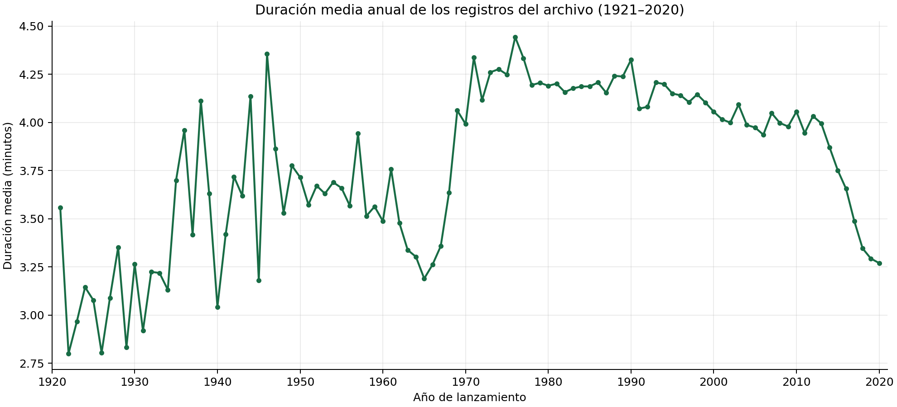

# Duración de canciones a través del tiempo y popularidad por año

Este caso parte de mi trabajo individual en el módulo Herramientas Básicas de Visualización de Datos del diplomado de la UPB. La actividad planteaba 20 preguntas sobre un archivo musical. Aquí destaco dos: cómo cambia la duración media de las canciones según su año de lanzamiento y cómo seleccionar la pista con mayor valor de popularidad de cada año.

## Problema

¿Cómo varía la duración media de los registros del archivo entre 1921 y 2020? Además, ¿qué pista tiene el mayor valor de popularidad en el archivo para cada año entre 1980 y 2020? Ambas preguntas se responden con los datos disponibles, sin asumir que representan a todo el catálogo de Spotify.



## Datos

Extraje `spotify_artists.csv` mediante una aplicación de mi cuenta de Spotify Developers durante el módulo. Contiene **163.661 registros** y ocho columnas: nombre, artista, año, duración, popularidad, energía, *danceability* y tempo. El archivo abarca **1921–2020**. Hay 871 filas sin artista; se conservan en el cálculo de duración porque el nombre del artista no es necesario para esa pregunta.

El CSV no está incluido. Quien tenga una copia autorizada puede colocarla en `data/spotify_artists.csv`. [Descripción de los datos y de la API de Spotify](data/README.md).

## Método

Convertí el año y la duración a valores numéricos, conservé las duraciones positivas y calculé la **duración media en minutos por año de lanzamiento**. La [tabla anual](results/duration_by_year.csv) permite consultar tanto el promedio como el número de registros detrás de cada punto del gráfico.

Para la selección anual, conservé los registros de 1980 a 2020 y ordené cada año por popularidad descendente. Cuando dos pistas tienen la misma popularidad, gana la de mayor `energy`; si persiste el empate, el nombre y el artista fijan un resultado estable. El [script](analysis.py) genera el gráfico y las dos tablas de resultados.

## Resultados

| Año | Registros | Duración media |
| --- | ---: | ---: |
| 1980 | 1.922 | 4,191 min |
| 2000 | 1.956 | 4,056 min |
| 2020 | 1.604 | 3,270 min |

La serie no sigue una línea recta: aumenta y fluctúa durante varias décadas, y los valores de los años recientes son menores que los de gran parte del periodo 1970–2000. En el archivo, la duración media de 2020 es **0,920 minutos menor** que la de 1980. La cantidad de registros varía entre años y la media puede verse afectada por canciones excepcionalmente largas.

La [selección por año](results/top_track_by_year.csv) reúne **41 pistas**, una por cada año de 1980 a 2020. Por ejemplo, en el archivo aparecen «Back In Black» para 1980, «In the End» para 2000 y «Hey, Soul Sister» para 2010. Es una selección según el valor de popularidad guardado en el CSV, no una clasificación histórica de popularidad en cada año de lanzamiento.

## Aprendizajes

- Para interpretar una evolución anual hay que mirar tanto el promedio como el número de registros de cada año; una línea por sí sola puede ocultar diferencias de cobertura.
- La pregunta sobre la pista más popular de cada año me enseñó a combinar filtros, ordenación y una regla de desempate. Para incluir 2020 hay que comprobar que el rango de años sea inclusivo y que `energy` solo decida entre pistas con igual popularidad.
- Una métrica de popularidad guardada en un archivo histórico no prueba qué canción era la más escuchada cuando se lanzó. Si repitiera el trabajo, documentaría el criterio de selección de las pistas y la fecha de consulta de las métricas.

## Habilidades técnicas aplicadas

- **Pandas y preparación:** cargué el CSV, revisé los valores faltantes y filtré años y duraciones válidas. Conservé las filas sin artista en el cálculo de duración porque ese campo no interviene.
- **Análisis exploratorio:** agrupé por año para calcular promedios y conteos; ordené las pistas por popularidad y usé `energy` para resolver empates.
- **Matplotlib:** construí el gráfico de duración media anual y publiqué los conteos que respaldan cada punto.

## Mi contribución

Extraje los datos con mi propia aplicación de la Spotify Web API y resolví individualmente las preguntas del módulo. El [notebook](notebooks/analisis_musical.ipynb) reúne las 20 consultas; el [script](analysis.py) genera los resultados destacados en esta página.

## Reproducir

Con Python 3.10 o posterior y una copia autorizada de `spotify_artists.csv`, desde la raíz del repositorio:

```powershell
python -m pip install -r requirements.txt
python analysis.py
```

El script guarda `results/duration_by_year.csv`, `results/top_track_by_year.csv` e `images/duration_by_year.png`.

Para recorrer las 20 preguntas, abre el notebook desde la raíz del repositorio y ejecuta las celdas en orden con el mismo CSV:

```powershell
jupyter lab notebooks/analisis_musical.ipynb
```

## Límites

No se conserva el procedimiento exacto con el que se obtuvo el CSV ni su criterio de selección. La popularidad y otras métricas de Spotify pueden cambiar con el tiempo. El análisis usa una extracción histórica y no permite inferir tendencias de todo el catálogo ni establecer causas. Tampoco permite saber si cada año del archivo contiene todas las pistas que se publicaron ese año.
